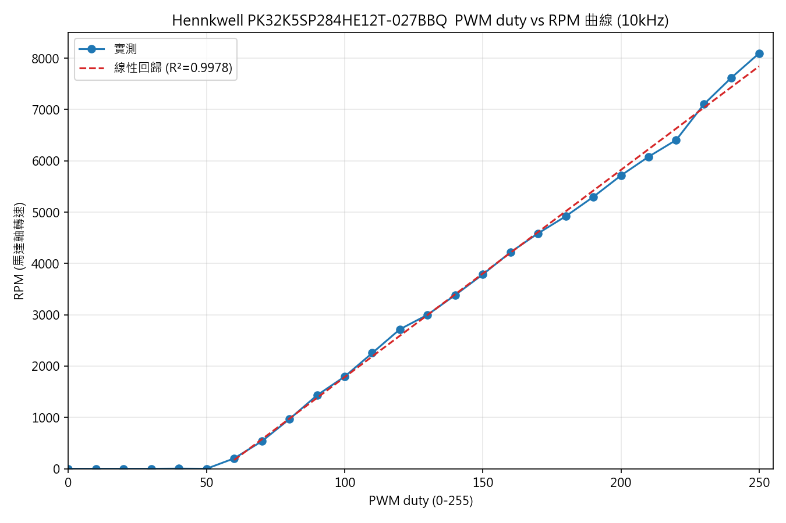

# 直流馬達＋編碼器 速度閉環 PID 教學指南
### 以 Hennkwell PK32K5SP284HE12T-027BBQ 為範例

本文件說明「拿到一顆新的直流馬達（含正交編碼器回授）之後，怎麼一步步做到速度閉環 PID 控制」的完整流程，用實際採購的這顆馬達當範例走一遍。之後接其他馬達，可以直接照這套流程套用。

**硬體架構**：BMduino (HT32F52367) 透過 I2C 控制 PCA9685（16 channel PWM 驅動板）輸出馬達方向訊號（數位 0/1），轉速訊號由 BMduino 自己軟體產生 PWM，編碼器 A/B 相接回 BMduino 的數位輸入腳做四倍正交解碼。

**參考韌體**：
- [firmware/hall_encoder_feedback_test/](../hall_encoder_feedback_test/hall_encoder_feedback_test.ino) — 基本編碼器讀值＋馬達驅動測試工具
- [firmware/hall_motor_pwm_sweep/](../hall_motor_pwm_sweep/hall_motor_pwm_sweep.ino) — PWM duty→RPM 特性掃描
- [firmware/hall_motor_pid_tune/](hall_motor_pid_tune.ino) — PID 速度閉環韌體（開放 Serial 指令即時調參，方便電腦端自動掃參數）

---

## 1. 馬達規格（本範例：PK32K5SP284HE12T-027BBQ）

| 項目 | 數值 |
|---|---|
| 型號 | PK32K5SP284HE12T-027BBQ（Hennkwell） |
| 類型 | DC 行星齒輪箱直流電刷馬達 + 內建磁性編碼器 |
| 操作電壓範圍 | 6~12 VDC |
| 額定電壓 | 12 VDC |
| 額定負載 | 5.6 kgf-cm |
| 空載轉速（輸出軸） | 313 ± 31 rpm |
| 額定負載轉速（輸出軸） | 269 ± 27 rpm |
| 空載電流（最大） | 0.56 A |
| 額定負載電流 | 2.6 A |
| 最大堵轉電流 | 23 A |
| 減速比 | 121 / 3249（≈ 1 : 26.85） |
| 編碼器 | 磁性編碼器，Incremental，**12 PPR**（裝在馬達軸，減速箱之前） |
| Hall sensor 相序 | B 先於 A（B>A），標示正轉方向 CCW |
| 輸出功率（最大效率點） | 15 W |
| 淨重 | 340 ± 20 g |

### 接頭線色定義（6P JST PHR-6）

| Pin | 顏色 | 功能 |
|---|---|---|
| 1 | 黑 | Motor − |
| 2 | 紅 | Motor + |
| 3 | 綠 | 編碼器 Ground |
| 4 | 棕 | Channel B |
| 5 | 黃 | Channel A |
| 6 | 橙 | Sensor Voltage+（2.4V~26V，霍爾感測器獨立供電，跟馬達動力線分開）|

**接線注意事項**：這類磁性編碼器模組通常是 4 條功能不同的線（Ground、Sensor Voltage+、Channel A、Channel B），不是單純「VCC/GND + A/B」兩組。橙線（Sensor Voltage+）是霍爾 IC 自己的供電，一定要接，範圍看 datasheet（本例 2.4V~26V）。接線前務必核對 datasheet 上的顏色定義，不同廠牌/批次的顏色定義可能不同。

---

## 2. 整體測試流程

1. **驗證馬達能正常驅動、編碼器能正常讀到回授**（用基本測試工具，手動轉軸確認方向/計數正確）
2. **量測 PWM duty → RPM 開環特性曲線**，確認線性度、算出死區與 feedforward 常數
3. **設計 PID 速度閉環控制器**（feedforward + PID + anti-windup + 輸出斜率限制）
4. **自動調參**找最佳 Kp/Ki
5. **全範圍驗證**：多組目標轉速逐一測試，確認實際收斂準確度

---

## 3. Step 1：驗證馬達驅動與編碼器回授

先用 [hall_encoder_feedback_test.ino](../hall_encoder_feedback_test/hall_encoder_feedback_test.ino) 這份最簡單的測試工具：

- 從 Serial 輸入 -255~255 的整數即可設定 PWM duty（正數正轉、負數反轉），韌體會持續印出目前 duty / 編碼器 tick 數 / 換算 RPM
- **確認方向**：手動輸入正 duty，tick 應該要持續增加；輸入負 duty，tick 應該要持續減少。如果方向相反，代表編碼器 A/B 兩相接線需要對調（不用改程式，直接對調實體接線即可）
- **確認 tick 平順累加**：正常的正交編碼器訊號應該讓 tick 隨時間平順遞增/遞減，不會卡在某個值附近亂跳。如果懷疑訊號有問題，可以分開統計 A、B 兩相各自的中斷觸發次數（edge count），正常情況下兩相的 edge 數量應該非常接近（差在相位 90°，不是次數）；如果兩者差異很大，通常代表接線或供電有問題，需要先排除再往下一步。

這一步做扎實，後面的 PWM 特性掃描跟 PID 才會準。

---

## 4. Step 2：PWM Duty → RPM 特性掃描

**目的**：找出「PWM duty」跟「馬達實際轉速」之間的開環關係，這是後面 feedforward 的基礎。

**方法**（見 [hall_motor_pwm_sweep.ino](../hall_motor_pwm_sweep/hall_motor_pwm_sweep.ino)）：讓馬達依序跑過 duty = 0, 10, 20, ..., 255，每個 duty 先等待 0.7 秒讓轉速穩定，再量測 1 秒內編碼器累積的 tick 數換算成穩態 RPM，輸出成 CSV。用 Python（matplotlib）畫圖、線性回歸。

### 本範例結果（PWM 頻率 10kHz）

- **線性回歸（馬達軸）**：`rpm = 40.3853 × duty − 2254.35`，**R² = 0.9978**（線性度非常好，代表這顆馬達在死區以上，duty 跟轉速幾乎成正比）
- **死區**：duty ≈ 56（duty=50 時 rpm=0，duty=60 時 rpm≈201）
- **最大轉速**：8095 rpm @ duty=250（馬達軸）≈ 301.5 rpm（輸出軸，跟 datasheet 空載規格 313±31rpm 吻合）



**換算成 feedforward 形式**（PID 控制時用這個公式，根據目標轉速直接估一個基準 duty）：

```
duty = 55.82 + 1.55 × (tick / 20ms)
```

---

## 5. 編碼器換算常數

| 常數 | 數值 | 說明 |
|---|---|---|
| `TICKS_PER_REV`（馬達軸） | 48 | 12 PPR × 4倍正交解碼 |
| 減速比 | 3249/121 ≈ 26.848 | 馬達軸→輸出軸轉速換算 |
| `PID_INTERVAL_MS` | 20 | PID 更新率 50Hz |
| `MAX_TICKS_PER_INTERVAL` | 129.52 | 對應 duty=250 滿速（8095rpm馬達軸） |

**通用公式**：`TICKS_PER_REV = 編碼器PPR × 4`（四倍正交解碼固定乘4）。如果編碼器裝在馬達軸（減速箱之前，本例即是如此），要換算成輸出軸轉速記得再乘上減速比的倒數。

---

## 6. Step 3：PID 速度閉環控制器設計

### 架構

```
Feedforward（前饋）+ 位置式 PID + Anti-windup + 輸出斜率限制
```

- **Feedforward（前饋）**：用 Step 2 量到的線性回歸，直接把「目標轉速」換算成「大概需要多少 duty」當基準。這樣 PID 只需要處理 feedforward 沒抓準的殘差，比純 PID（沒有前饋）收斂快很多、震盪也小很多。
- **位置式 PID**：每個控制週期直接算出完整的 duty 輸出值（`duty = feedforward + Kp×error + Ki×積分`），不是把修正量疊加在上次的 duty 上（那樣容易累積誤差、造成暴衝）。
- **Anti-windup**（積分抗飽和）：如果這次算出來的輸出已經會撞到 duty 的上下限（0 或 255），就先不要把這次的誤差累加進積分項，避免積分越滾越大、之後要花很久才能退回來。
- **輸出斜率限制（slew rate limit）**：duty 每個控制週期最多只能變動一個固定量（本例 15）。這是因為馬達本身有轉動慣量，如果目標速度突然階躍變化，feedforward+Kp×error 算出來的 duty 可能瞬間衝到很高，讓馬達衝過頭（overshoot）之後才被 PID 拉回來，造成持續震盪。加上這個限制等於是強制「軟啟動」，讓 duty 平滑過渡。

### 本範例最終參數

| 參數 | 數值 |
|---|---|
| Kp | 0.25 |
| Ki | 0.04 |
| 積分限幅 | 300 |
| 輸出斜率限制 | 15 duty/週期 |

---

## 7. Step 4：自動調參方法

韌體（[hall_motor_pid_tune.ino](hall_motor_pid_tune.ino)）開放 Serial 指令即時調整參數，不用每組參數都重新燒錄：

| 指令 | 說明 |
|---|---|
| `t <-100~100>` | 設定目標速度百分比 |
| `kp <float>` | 設定 Kp |
| `ki <float>` | 設定 Ki |
| `slew <float>` | 設定輸出斜率限制 |
| `reset` | 清空積分項、濾波速度（換參數後、測新的階躍前建議先 reset） |

**自動掃參數方法**：電腦端寫 Python 腳本，對一組 (Kp, Ki) 網格逐一測試——每組先送 `reset`，再送一個固定的目標速度階躍（本例用 60%），量測接下來幾秒的響應，計算幾個指標：

- **Overshoot**：實際值超過目標值的最大幅度
- **穩態誤差**：響應後段（穩定後）跟目標值的差距
- **穩態震盪**：響應後段的標準差，衡量收斂後還在不在晃
- **上升時間**：從 0 追到目標 90% 所花的時間

把這幾個指標依重要性加權算成一個分數（分數越低越好），跑完整個網格後挑分數最低的一組。

**參數選擇上的取捨**：完全不用積分（Ki=0）通常 overshoot 最小、最穩定，但會永遠留著幾 % 的穩態誤差追不上去；加一點點 Ki 可以把穩態誤差壓到接近 0，但代價是 overshoot 會增加。實務上要依應用情境決定哪個更重要——長時間定速運轉的應用通常比較在意穩態誤差，快速換檔的應用可能比較在意 overshoot 小、不衝過頭。

### 本範例階躍響應（目標60%）

| 指標 | 數值 |
|---|---|
| Overshoot | ~10.7% |
| 穩態誤差 | ~0.01%（幾乎為0） |
| 穩態震盪（標準差） | ~0.5% |
| 上升時間（到目標90%） | ~319 ms |

---

## 8. Step 5：全範圍驗證

參數選定後，別只測一個點，要在整個實用轉速範圍內都測過，確認每個目標都能準確收斂。本範例測試輸出軸目標轉速 60~330rpm（每 30rpm 一階）：

| 目標 (rpm) | 收斂值 (rpm) | 誤差 |
|---|---|---|
| 60 | 58.9 | −1.8% |
| 90 | 90.4 | +0.5% |
| 120 | 117.1 | −2.4% |
| 150 | 150.3 | +0.2% |
| 180 | 178.5 | −0.8% |
| 210 | 209.6 | −0.2% |
| 240 | 238.0 | −0.8% |
| 270 | 269.6 | −0.2% |
| 300 | 299.0 | −0.3% |
| 330 | 314.2 | −4.8%（duty已頂到255，超過馬達物理極速）|

**結論**：60~300 rpm 範圍內，PID 皆能準確收斂到目標值，誤差普遍在 ±1% 以內。330rpm 超出馬達實測物理極速上限（約300~314rpm，跟 datasheet 空載規格吻合），這種情況下 duty 會頂到 255 無法再往上，是馬達本身的物理限制，不是 PID 調校的問題——**設計目標轉速範圍時，記得先確認有留在馬達的實際可達轉速之內**。

---

## 9. 附錄：換算公式

```
輸出軸rpm → 目標百分比(t指令)：
  馬達軸rpm = 輸出軸rpm × (減速比)
  ticks/PID週期 = 馬達軸rpm × TICKS_PER_REV/60 × (PID_INTERVAL_MS/1000)
  target% = ticks/PID週期 ÷ MAX_TICKS_PER_INTERVAL × 100

實際回報值(actual, 單位ticks/PID週期) → 輸出軸rpm：
  輸出軸rpm = actual ÷ TICKS_PER_REV × (60000/PID_INTERVAL_MS) ÷ 減速比
```

（本範例代入：TICKS_PER_REV=48、PID_INTERVAL_MS=20、減速比=3249/121≈26.848、MAX_TICKS_PER_INTERVAL=129.52）
