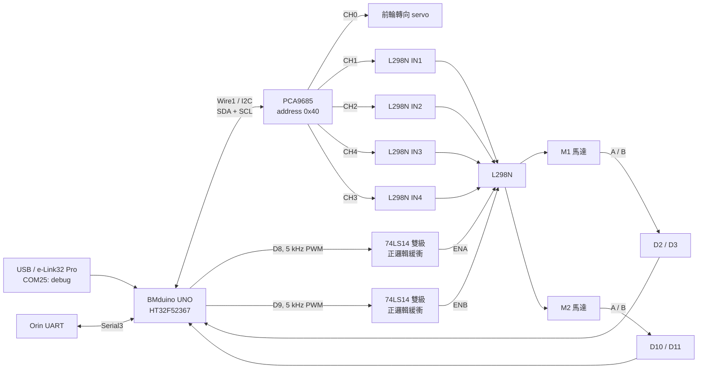

# 車一目前接線圖：BMduino + PCA9685 + L298N

更新：2026-10-08。此表以目前診斷韌體
`car1_l298n_diagnostic` 與原本正式韌體的共同腳位定義為準。實車接線優先；
所有標示「待量測」的項目要以今天的 L298N 實體端子為準。

## 控制鏈路

## 腳位對照

| 功能 | BMduino／PCA 腳位 | 預期接到 | 已知狀態 |
|---|---|---|---|
| PCA I²C | Wire1（BMCOM1） | PCA9685 SDA/SCL | **已驗證**：位址 `0x40` ACK |
| PCA 方向輸出 M1 | CH1 / CH2 | L298N IN1 / IN2 | 待量測輸出端與接頭 |
| PCA 方向輸出 M2 | CH3 / CH4 | L298N IN3 / IN4 | 使用者已於 2026-10-08 量測確認 |
| M1 Enable PWM | D8 → 74LS14 雙級 | L298N ENA | **2026-10-08 單獨 Enable 實測確認** |
| M2 Enable PWM | D9 → 74LS14 雙級 | L298N ENB | 依 M1 測試結果確認兩線與舊紀錄相反；待 M2 動作驗證 |
| M1 encoder | D2=A、D3=B | M1 encoder A/B | F=`+7623`、R=`-7774`（255 duty、1 s） |
| M2 encoder | **2026-10-13 起 D10=A、D11=B**（原 D6=A、D7=B） | M2 encoder A/B | F=`-6543`、R=`+6475`（255 duty、1 s） |
| 轉向 | PCA CH0 | 前輪轉向 servo signal | 本次未測 |

## 共用電源與必要條件

所有下列地端必須相連：BMduino GND、PCA9685 GND、74LS14 GND、L298N GND、
馬達電源負端、兩個 encoder GND。缺少共地時，即使 I²C ACK 或 PWM 波形存在，
L298N 也可能不動。

| 電源／控制條件 | 目的 | 量測或確認方式 |
|---|---|---|
| L298N 馬達電源 | 提供馬達動力 | 量測 L298N 馬達電源端，確認保險絲／開關／端子 |
| L298N 邏輯 5 V | 讓 IN／EN 邏輯有效 | 依模組的 5 V jumper／regulator 配置確認 |
| PCA9685 VCC + V+ | I²C 邏輯與輸出級供電 | `0x40 ACK` 只表示 VCC/I²C 可通；**另量 V+** |
| PCA9685 OE | 必須為 LOW 才啟用輸出 | 若模組拉出 OE 腳，確認沒有被拉 HIGH |
| 74LS14 5 V | 將 D8/D9 的 3.3 V 整形成 5 V 邏輯 | 量測 IC 電源與 ENA/ENB 端的波形 |
| ENA/ENB jumper cap | 允許外部 PWM 控制 | L298N 的 ENA、ENB 跳線帽必須拔除 |

## 診斷時應看到的邏輯狀態

診斷韌體的 `pulse` 指令會先停用 Enable，再設定方向，最後只開啟指定輪的
PWM。測量訊號時以 L298N 輸入端為準。

| 指令 | PCA CH1 | PCA CH2 | PCA CH3 | PCA CH4 | D8 / ENA | D9 / ENB |
|---|---:|---:|---:|---:|---|---|
| `pulse M1 F ...` | HIGH | LOW | LOW | LOW | 5 kHz PWM | LOW |
| `pulse M1 R ...` | LOW | HIGH | LOW | LOW | 5 kHz PWM | LOW |
| `pulse M2 F ...` | LOW | LOW | HIGH | LOW | LOW | 5 kHz PWM |
| `pulse M2 R ...` | LOW | LOW | LOW | HIGH | LOW | 5 kHz PWM |
| `stop`／待機 | LOW | LOW | LOW | LOW | LOW | LOW |

## 今天的實測紀錄

| 時段 | 結果 | 意義 |
|---|---|---|
| 初次 M1 測試 | F20/250 ms = `+1547`、R20/250 ms = `-1575` | 當時 M1 馬達與 encoder 都能工作，encoder 極性正常 |
| M2 多次測試 | F/R 20、F40、F/R60 均為 `0` | M2 沒有 encoder 回授；需先確認是否實際轉動 |
| D8/D9 sweep | 使用者確認兩腳都有 PWM 訊號 | BMduino PWM 軟體與 74LS14 前端至少有訊號 |
| PCA 重新插接後 | `PCA9685,address=0x40,i2c_result=0,ack=yes` | I²C SDA/SCL 與 PCA 位址可通訊 |
| PCA ACK 後 M1 階梯 | F80→60→40→20 均為 `0` | 尚未恢復完整的方向／動力鏈路，不能只以 ACK 判定 PCA 輸出有效 |
| D8/D9 mapping test | 固定 M1 方向時，D9-only=`0`、D8-only=`+7664` | **實際是 D8→ENA（M1）、D9→ENB（M2）** |
| 修正後全 duty 正反測試 | M1 F/R=`+7623/-7774`；M2 F/R=`-6543/+6475` | 兩輪馬達與 encoder 均可用；每輪符號固定且正反相反 |

## 下一個最短排查順序

1. 發送 `pulse M1 F 80 500`，量測 **PCA CH1、CH2 的 PCA 板端**：預期 CH1 HIGH、CH2 LOW。
2. 同一次脈衝量測 **L298N IN1、IN2 端**：應與 CH1、CH2 相同。若 PCA 板端正確、L298N 端不正確，問題在這段線束／接頭。
3. 量測 L298N 的 ENA：應有 D9 經 74LS14 後的 5 kHz PWM。若 D9 有而 ENA 沒有，問題在 74LS14 或 ENA 線束。
4. 若 IN1/IN2 與 ENA 都正確，量測 L298N 馬達電源、邏輯 5 V 和共地，再檢查 OUT1/OUT2 到 M1 的端子。
5. M1 恢復轉動後，再以同樣流程查 M2 的 IN3/IN4、ENB 和 D6/D7 encoder。
